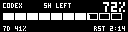
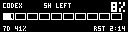
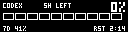
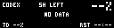
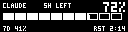

# zmk-tom-oled

`zmk-tom-oled`は、128×32の横向きOLEDに対応したZMKディスプレイシールドです。

`central`側には、次の情報を表示します。

- USB/Bluetoothの接続状態
- WPM連動のBongo Cat、AI利用枠の全画面表示、Codex/Claude Codeのタスク状態（キー操作で切替）
- 有効な修飾キー
- 使用中のレイヤー
- `central`および`peripheral`のバッテリー残量

`peripheral`側には、端末上で取得できる範囲の情報を表示します。

- `central`との接続状態（`CONN OK` / `CONN --`）
- キー入力
- トラックボール操作のアニメーション（`central`側の操作もsplit relayで反映）
- 切断時のアニメーション

## Usage

現在の`main`ブランチは、ZMK v0.4（Zephyr 4.1 / LVGL 9）向けです。

`config/west.yml`にこのモジュールを追加し、`west update`を実行します。

```yaml
manifest:
  remotes:
    - name: zmkfirmware
      url-base: https://github.com/zmkfirmware
    - name: pukuhei
      url-base: https://github.com/pukuhei
  projects:
    - name: zmk
      remote: zmkfirmware
      revision: main
      import: app/west.yml
    - name: zmk-tom-oled
      remote: pukuhei
      revision: main
  self:
    path: config
```

左右それぞれのビルドターゲットへ、`tom_oled`シールドを追加します。

```yaml
---
include:
  - board: xiao_ble//zmk
    shield: your_keyboard_left tom_oled
  - board: xiao_ble//zmk
    shield: your_keyboard_right tom_oled
```

OLEDを180度回転して取り付ける場合は、`tom_oled`の後ろへ
`tom_oled_180`を追加します。SSD1306のハードウェア反転を使用するため、文字や
アニメーションを含む画面全体が回転します。

```yaml
---
include:
  - board: xiao_ble//zmk
    shield: your_keyboard_left tom_oled tom_oled_180
  - board: xiao_ble//zmk
    shield: your_keyboard_right tom_oled tom_oled_180
```

通常の向きへ戻す場合は、シールド一覧から`tom_oled_180`を外してください。

## Configuration

`peripheral`に加えて、`central`側のバッテリー残量も表示します。

```conf
CONFIG_ZMK_TOM_OLED_DONGLE_BATTERY=y
```

修飾キーをmacOSの記号で表示します。

```conf
CONFIG_ZMK_TOM_OLED_MAC_MODIFIERS=y
```

### OLED表示の切り替えとAgent status

中央OLEDのBongo Catと、CodexまたはClaude Codeのタスク状態（`WORK` / `WAIT` /
`DONE` / `FAIL` / `OFF`）は、どちらもファームウェアに含まれます。keymapまたは
DYA/ZMK Studioで、任意のキーへ`&oled_mode`（表示名: `OLED Mode Toggle`）を割り当てると、
Bongo Cat → AI利用枠 → Agent status → Bongo Cat の順に切り替えられます。選択したモードは、Settingsが有効なファームウェアでは再起動後も保持
されます。

この機能を含むファームウェアへ一度だけ更新すれば、その後は表示モードを変えるたびに
ファームウェアをビルドし直す必要はありません。

初回起動時の表示だけは、次の設定で選択できます。既にキーで選択済みの場合は、その保存値が
優先されます。

```conf
CONFIG_ZMK_STUDIO=y
# y: Agent status、n: Bongo Cat（既定値）
CONFIG_ZMK_TOM_OLED_CODEX_STATUS=n
```

状態は、ZMK Studioの暗号化されたBLE characteristicを通じて受信します。一定時間
更新がなければ自動的に`OFF`へ戻るため、Macのスリープ後も古い状態が残りません。

#### macOS app

Codex Desktop / CLIとClaude Codeから監視対象を選び、状態をBluetooth経由で
キーボードへ送信するmacOSメニューバーアプリを同梱しています。Claude Code側の
settingsやHooksの変更、Python bridgeの導入、アプリのビルドは不要です。

Claude Codeはローカルのsession JSONLから状態を判定します。Hooksを使用しないため、
`WAIT`は明示的な入力要求を検出した場合に表示され、一般的なツール権限ダイアログは
`WORK`のままになることがあります。

- [Agent OLED 0.2.0 for macOS（Apple Silicon）](apps/Agent-OLED-0.2.0-macOS-arm64.zip)

1. ZIPを展開し、`Agent OLED.app`を「アプリケーション」フォルダへ移動します。
2. 初回起動時はControlキーを押しながらアプリをクリックし、「開く」を選択します。
3. macOSから確認されたら、Bluetoothの使用を許可します。
4. メニューバーからAgent OLEDを開き、監視するタスクとキーボードを選択します。

対応環境はmacOS 14以降を搭載したApple Silicon Macです。Codex状態を受信するには、
キーボード側で`CONFIG_ZMK_STUDIO=y`を有効にしてください。Bongo Cat表示のままでも
状態は受信・保持され、`&oled_mode`でAgent statusへ戻した時点で最新状態を表示します。

#### ステータスの種類


| 表示 | 状態 |
| --- | --- |
| `WORK` | CodexまたはClaude Codeがタスクを処理中 |
| `WAIT` | ユーザーの入力または承認待ち |
| `DONE` | タスクが完了 |
| `FAIL` | タスクが失敗または中断 |
| `OFF` | 監視対象なし、または状態の有効期限切れ |

### AI利用枠（全画面）

CodexまたはClaude Codeの**アカウント利用枠の残り%**を、128×32の全画面で表示します。
金額、会話のコンテキスト長、残りトークン数ではありません。表示の意味はKYURENと同じです。

| normal | low | zero | nodata | claude |
| --- | --- | --- | --- | --- |
|  |  |  |  |  |

- 上段: 対象AIと主枠（短い方の枠。例 `5H`）、右上に主枠の残り%
- 中段: 10区画ゲージ。白い中身＝残量、輪郭＝使用済み
- 下段: 副枠（例 `7D`）の残り%と、主枠のリセットまでの時間（`H:MM`、6000分以上は日数）
- 未取得・取得失敗・期限切れは`--%`と`NO DATA`。0%とは区別し、ゲージを表示しません

値はZMK Studio custom RPC `tom_oled__agent_quota`で受信します。リセットまでの時間は
キーボード側でカウントダウンし、TTL（既定300秒）を過ぎるか枠のリセット時刻を過ぎると
`NO DATA`へ戻ります。送信元は同梱のAgent OLED（0.3.0以降）です。

```conf
# 既定値
CONFIG_ZMK_TOM_OLED_AGENT_QUOTA_STUDIO_RPC=y
CONFIG_ZMK_TOM_OLED_AGENT_QUOTA_DEFAULT_TTL_SEC=300
```

描画は`widgets/agent_quota_render.c`（Zephyr非依存）にあり、
`python3 tools/check_agent_quota_render.py`でホストコンパイルし、上の承認済み画像と
1ピクセル単位で一致することを確認できます。

## Notes

このモジュールは`zmk-dongle-display`をベースとしており、`central`側のステータス
画面も近い構成を維持しています。一方、`peripheral`側ではZMKのendpoint、layer、
split batteryなどの情報を同じ方法で取得できません。そのため、接続状態とキー入力を
中心にした専用ウィジェットを使用しています。トラックボール操作だけは左右どちらが
`central`でも反映できるよう、軽量なactivityイベントをsplit relayで転送します。

## References

`central`側の表示は、Maximilian Englさんの
[`zmk-dongle-display`](https://github.com/englmaxi/zmk-dongle-display)
を参考にしています。
